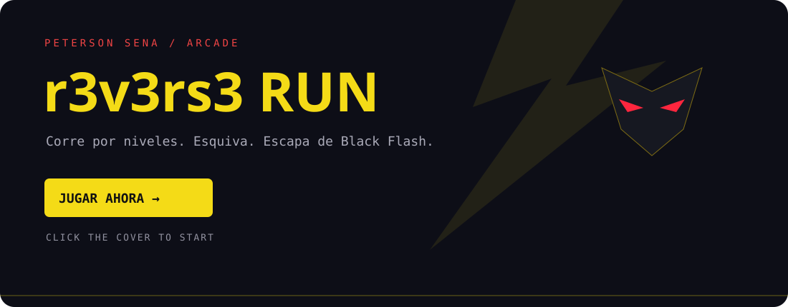

# r3v3rs3 RUN

Juego de navegador para el README de Peterson Sena. Corre con un velocista 3D, supera varios niveles y evita que Black Flash te alcance.

## Probar el juego
Abre [la página del juego](https://petersonsenadevs.github.io/r3v3rs3-game/). El enlace **JUGAR AHORA** del README abre la partida directamente en modo de juego; el velocista y el HUD ocupan la zona central de la portada.

En local, extrae el ZIP y abre `index.html` en Chrome o Edge.

- `Espacio` o `↑`: saltar.
- `↓` o `S`: deslizarse bajo barreras.
- `P`: pausar.
- En móvil: toca el escenario para saltar.
- Recoge rayos para sumar 50 puntos y alejar a Black Flash.

El récord se guarda en el navegador local.

## Portada del README
La portada SVG muestra un botón gráfico y funciona como un único enlace al juego:

```html
<a href="https://petersonsenadevs.github.io/r3v3rs3-game/#play">
  
</a>
```

GitHub no ejecuta el juego dentro del README: al pulsar la portada, abre GitHub Pages y comienza allí. En esa página el juego se adapta al mismo formato panorámico de la portada.
